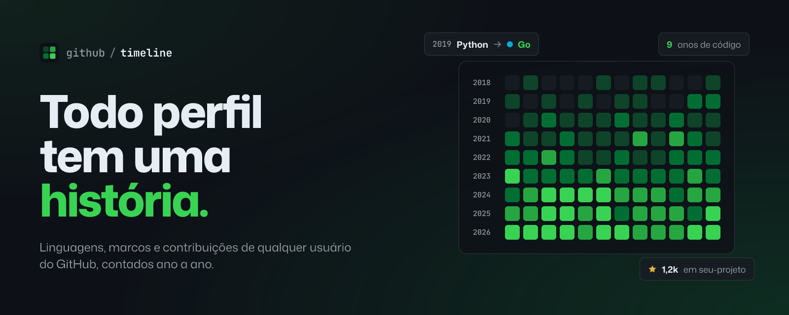

<p align="center">
  <a href="https://github-timeline.frangolab.com">
    
  </a>
</p>

<p align="center">
  <a href="https://github-timeline.frangolab.com"><b>github-timeline.frangolab.com</b></a>
  &nbsp;·&nbsp;
  <a href="#-comece-agora">Comece agora</a>
  &nbsp;·&nbsp;
  <a href="#-badge-para-o-readme">Badge</a>
  &nbsp;·&nbsp;
  <a href="CONTRIBUTING.md">Como contribuir</a>
</p>

<p align="center">
  
  
  
  
</p>

---

O gráfico de contribuições mostra **quanto** alguém programou. O **GitHub Timeline** conta **o quê**: digite um username e veja a trajetória ano a ano, com as linguagens que chegaram, os projetos que ganharam stars, as viradas de stack e os marcos que ficam escondidos numa lista de repositórios.

Nada é escrito à mão nem inventado. Cada frase sai dos dados públicos do GitHub.

## ✦ Comece agora

Não precisa instalar nada. Troque `<username>` pelo perfil que quiser:

| Quero…                        | Endereço                                                            |
| ----------------------------- | ------------------------------------------------------------------- |
| ver a timeline de alguém      | `https://github-timeline.frangolab.com/u/<username>`                |
| comparar dois perfis          | `https://github-timeline.frangolab.com/u/<a>...<b>`                 |
| uma imagem para compartilhar  | `https://github-timeline.frangolab.com/u/<username>/card.png`       |
| um badge para o README        | `https://github-timeline.frangolab.com/badge/<username>.svg`        |
| embeds animados para o README | `https://github-timeline.frangolab.com/embed/<username>/trilha.svg` |

A primeira visita a um perfil dispara a coleta, e a página mostra o progresso ao vivo. Daí em diante o snapshot fica salvo e abre na hora.

## ✦ O que aparece na timeline

- **Manchete**: o perfil resumido numa frase, como _"9 anos de código. De Python a Go."_ ou _"12k ★ em seu-projeto."_
- **Capítulos por ano**: o que estreou em cada ano (linguagens, topics) e os repositórios em destaque, ordenados por stars, forks, descrição e atividade.
- **Contribuições reais**: grade mensal com os dados do calendário de contribuições do GitHub, inclusive em organizações.
- **Conquistas**: primeiro repo, primeiro fork, 100 e 1.000 stars, poliglota, ano recorde, uma década de código e outras.
- **Organizações**: perfis de organização mostram os maiores contribuidores.
- **Dois temas**: claro e escuro, seguindo o sistema ou a sua escolha, em layout pensado também para celular.

## ✦ Idiomas

O app oferece **português brasileiro e inglês**. O idioma é identificado pelo cabeçalho
`Accept-Language` do navegador; quando nenhum idioma compatível é informado, usa português.
O seletor no topo permite trocar o idioma, e a escolha fica salva em cookie por um ano.
Selecione **Automático** para voltar à preferência do navegador.

Links com `?lang=pt-BR` ou `?lang=en` abrem no idioma indicado e salvam essa preferência.
Cards, badges e links de compartilhamento acompanham o idioma escolhido. Nomes e descrições
vindos do GitHub permanecem no idioma original. Os snapshots existentes são localizados na
apresentação, sem uma nova coleta.

## ✦ Compare dois perfis

Junte dois usernames com `...` e veja os dois lado a lado: números, linguagens em comum, quem estreou primeiro e um resumo do duelo.

```
https://github-timeline.frangolab.com/u/torvalds...gvanrossum
```

## ✦ Card para compartilhar

Toda timeline tem um PNG 1200×630, já usado nas meta tags Open Graph. Colou o link no LinkedIn, no X ou no Discord, a prévia aparece sozinha.

```
/u/<username>/card.png?tema=claro&variante=numero
```

| Parâmetro  | Valores                                                 | Padrão     |
| ---------- | ------------------------------------------------------- | ---------- |
| `tema`     | `escuro`, `claro`                                       | `escuro`   |
| `variante` | `headline` (manchete), `numero` (total de repositórios) | `headline` |

## ✦ Badge para o README

Um selo que se atualiza sozinho e leva quem clicar direto para a sua timeline:

```md
[](https://github-timeline.frangolab.com/u/seu-username)
```

O badge mostra o intervalo de anos e o total de repositórios, por exemplo `2019–2026 · 83 repos`.

### Embeds

Imagens maiores, em SVG, para colar no profile README. A trilha e o rio são animados só com CSS e rodam em loop.

| Embed              | Endereço                                     | Mostra                                                            |
| ------------------ | -------------------------------------------- | ----------------------------------------------------------------- |
| Trilha da carreira | `/embed/<username>/trilha.svg`               | contribuições mês a mês da carreira toda, com as eras de cada ano |
| Rio de linguagens  | `/embed/<username>/linguagens.svg`           | repositórios criados por linguagem em cada ano                    |
| Conquistas         | `/embed/<username>/conquistas.svg`           | as 9 conquistas, com as bloqueadas e o que falta                  |
| Conquistas à mão   | `/embed/<username>/conquistas/<id>,<id>.svg` | só as conquistas escolhidas, na ordem da URL                      |

Ids das conquistas: `primeiro-repo`, `estrelado`, `stars-100`, `stars-1000`, `primeiro-fork`, `poliglota`, `ano-recorde`, `uma-decada`, `topics-50`.

Todos aceitam `?tema=escuro|claro` e `?lang=pt-BR|en`. A trilha e o rio aceitam também `?paleta=`: na trilha, `roxo` (padrão), `verde`, `azul`, `ambar` ou `rosa`; no rio, `linguagens` (padrão, cores do Linguist), `aurora` ou `por-do-sol`. A trilha aceita ainda `?estilo=compacto`, que deixa só os anos sob a grade, sem total nem descrição. Para seguir o tema de quem visita o seu perfil:

```html
<picture>
  <source
    media="(prefers-color-scheme: dark)"
    srcset="https://github-timeline.frangolab.com/embed/seu-username/trilha.svg?tema=escuro"
  />
  
</picture>
```

## ✦ API

Os mesmos dados da página, em JSON:

| Rota                          | Retorna                                                     |
| ----------------------------- | ----------------------------------------------------------- |
| `GET /api/profile/<username>` | snapshot completo (manchete, anos, linguagens, conquistas…) |
| `GET /api/status/<username>`  | progresso da coleta via Server-Sent Events                  |
| `GET /healthz`                | estado do servidor e cota restante da API do GitHub         |

```sh
curl -s https://github-timeline.frangolab.com/api/profile/torvalds | jq .headline
```

## ✦ Como funciona

```
username ─▶ coleta (REST + GraphQL) ─▶ snapshot no SQLite ─▶ páginas SSR, card PNG, badge SVG
```

1. **Coleta**: o servidor busca perfil, repositórios públicos, organizações e o calendário de contribuições com o próprio token.
2. **Derivação**: anos, linguagens, manchete e conquistas são calculados a partir dos metadados (datas de criação e push, linguagem, topics, stars, forks, homepage).
3. **Snapshot**: o resultado fica guardado por 12 h. Depois disso, a próxima visita coleta de novo.
4. **Render**: páginas renderizadas no servidor com Hono, card desenhado com Satori + resvg, badge em SVG puro.

### Limites e privacidade

- Só dados **públicos**: repositórios privados nunca aparecem.
- No máximo 3 coletas simultâneas e 10 timelines novas por IP a cada 10 minutos. Perfis já salvos não contam.
- Com menos de 10% da cota do GitHub, o servidor serve só snapshots salvos e avisa quando o dado está antigo.
- O indicador **"X timelines geradas"** acumula cada abertura bem-sucedida de uma timeline, inclusive acessos repetidos ao mesmo perfil e perfis em cache. Dez visitantes abrindo o mesmo perfil somam dez; uma nova abertura também conta. Requisições HEAD, buscas, comparações, imagens, API, páginas em coleta e erros não incrementam esse indicador.
- Para "Em alta", visitas guardam apenas username, dia UTC e um hash diário do IP por 30 dias. O ranking mantém um visitante por perfil/dia na janela de 7 dias; redes com IP compartilhado podem agrupar visitantes.
- Agregados diários de aberturas por perfil e de eventos HTTP por tipo, status e idioma são preservados, sem IP, hash de visitante ou query string. Health checks, arquivos estáticos e rotas desconhecidas não entram nos eventos.

### Estatísticas de uso

A página pública **`/estatisticas`**, acessível pelo rodapé, mostra o total acumulado,
indicadores de timelines, perfis distintos, buscas válidas e comparações abertas;
um gráfico de aberturas por dia com tabela acessível; um ranking dos dez perfis
mais acessados; e totais de uso da home, cards, badges e API. Os filtros de 7, 30 e
90 dias atualizam todas as métricas do período. As datas usam UTC e o dia atual
é parcial. A página segue os temas e idiomas do projeto.

A leitura usa exclusivamente `timeline_daily` e `event_daily`. Nenhum IP, hash,
identificador de visitante ou termo de busca é consultado ou enviado à página.
Somente usernames públicos de perfis gerados e contagens agregadas aparecem no ranking.
As buscas contam redirecionamentos válidos (302); comparações e demais recursos
contam respostas bem-sucedidas (200). Visitas ao dashboard são registradas como
`statistics` e não incrementam o contador de timelines.

As migrações do SQLite criam `timeline_daily` e `event_daily` automaticamente. O histórico de visitas ainda disponível é incorporado uma única vez; acessos antigos já apagados ou deduplicados não podem ser reconstruídos. A partir da atualização, os agregados persistem entre reinícios e após a limpeza dos hashes.

Consulte o banco configurado em `DATABASE_PATH` para analisar as estatísticas:

```sql
-- Total exibido na página inicial.
SELECT COALESCE(SUM(total), 0) AS timelines FROM timeline_daily;

-- Aberturas por dia e perfil, incluindo repetições.
SELECT day, username_key, total FROM timeline_daily ORDER BY day DESC, total DESC;

-- Buscas, comparações, timelines, imagens e API por resultado e idioma.
SELECT day, event, status, locale, total FROM event_daily ORDER BY day DESC, total DESC;
```

Os eventos são `landing`, `search`, `comparison_search`, `timeline`, `comparison`, `card`, `badge`, `api_profile`, `api_status` e `language_change`. O status permite distinguir buscas válidas (302), entradas inválidas (400), páginas em coleta (202), perfis ausentes (404), limites (429) e indisponibilidade (503). A captura mede requisições GET atendidas pelo servidor, incluindo robôs; cards e badges servidos pelo cache do navegador ou de proxies não geram um novo evento. Uma falha na gravação de eventos HTTP gera o log JSON `usage.record_failed`.

## ✦ Stack

**TypeScript** · **Hono** (rotas e JSX no servidor) · **SQLite** via better-sqlite3 · **Satori + resvg** (card PNG) · **Vitest** · **Docker**. Fontes Mona Sans e JetBrains Mono hospedadas no próprio servidor, sem dependência de CDN.

## ✦ Contribuições

Contribuições são muito bem-vindas! Encontrou um bug, pensou numa conquista nova ou numa forma melhor de contar a história de um perfil? Abra uma [issue](https://github.com/Moscarde/github-timeline/issues) ou mande um pull request; o guia [Como contribuir](CONTRIBUTING.md) mostra como rodar o projeto na sua máquina.

<p align="center"><sub>Feito por <a href="https://github.com/Moscarde">@Moscarde</a> · se o projeto te ajudou, deixe uma ⭐</sub></p>
